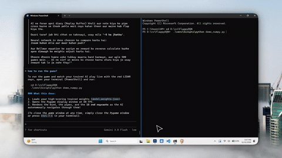

# FlappyDQN 🐦🤖

Deep Q-Learning (Double DQN) agent trained from scratch to master Flappy Bird using 15-Ray LIDAR obstacle detection and PyTorch.

## 🎥 Gameplay Demo
<p align="center">
  
</p>

## ✨ Features
- **15-Ray LIDAR Raycasting:** Multi-angle ray collision detection against pipes, ceiling, and ground.
- **Double Deep Q-Network (DDQN):** Decouples action selection from action evaluation to eliminate Q-value overestimation bias.
- **Spawn Jitter:** Bird starts at randomized altitudes and velocities during training to prevent opening Pipe-0 chokes.
- **Zero-Dependency Local Inference:** Runs real-time gameplay at 60 FPS using pure NumPy (`demo_numpy.py`), without needing PyTorch or CUDA locally!
- **Fast Headless Cloud Training:** Ready-to-run Google Colab notebook (`train_colab.ipynb`).

## 🚀 Quick Start

### 1. Run Pretrained Model (Locally with Pure NumPy)
No heavy GPU or PyTorch install needed!
```bash
git clone https://github.com/MuhammadMustafa18/FlappyDQN.git
cd FlappyDQN
pip install numpy pygame-ce
python demo_numpy.py
```

### 2. Train on Google Colab
Open `train_colab.ipynb` directly in [Google Colab](https://colab.research.google.com), click **Runtime > Run all**, and it will train for ~2,500–6,000 episodes and auto-download `model_weights.json`.
